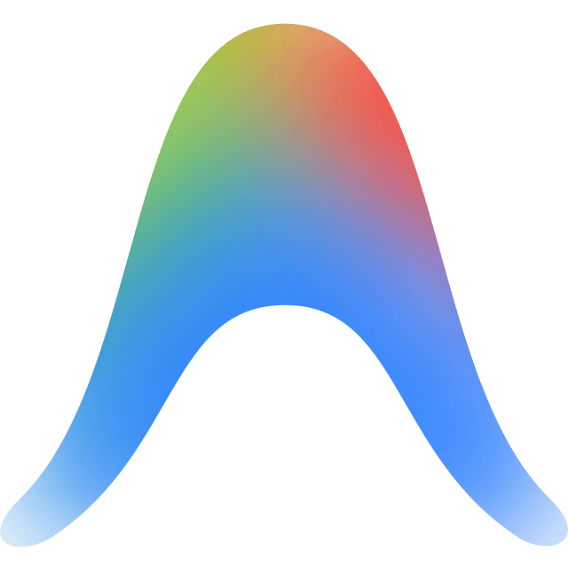
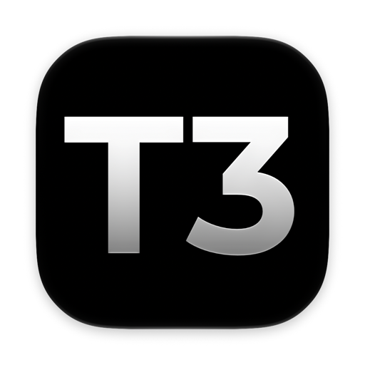
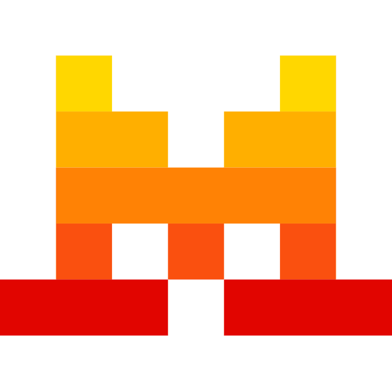

<div align="center">

<p>
  &nbsp;
  &nbsp;
  &nbsp;
  &nbsp;
  &nbsp;
  &nbsp;
  &nbsp;
  
</p>

# agent-rpc

**Discord Rich Presence universel pour TOUS tes agents IA de code**

[](https://nodejs.org/)
[](#architecture)
[](#agents-pris-en-charge)
[](LICENSE)

*Inspiré de `claude-rpc`, pensé dès le départ pour **Antigravity, Claude Code, Codex, OpenCode, T3 Code, Cursor, Mistral Vibe, GitHub Copilot, Grok CLI, Hermes, Gemini CLI, Windsurf, Cline** et absolument tout le reste.*

</div>

---

## Aperçu

```text
┌──────────────────────────────────────────────────────────┐
│ Joue à                                                   │
│  [Logo officiel]  Antigravity                            │
│                   Gemini 4 Neon · 197.6M tok/wk          │
│                   👥 session 12.1M · mon-projet (3 sur 3)│
│                   🎮 38:43                               │
│  [                  Get agent-rpc →                   ]  │
└──────────────────────────────────────────────────────────┘
```

> **Astuce multi-RPC** : si tu utilises déjà une autre app qui prend le slot `Joue à` (un jeu, un timer focus, etc.), passe `activityType` à `3` (*Regarde*), `2` (*Écoute*) ou `5` (*Participe à*) : **`agent-rpc` se superpose automatiquement** juste en dessous (`Regarde Antigravity`, `Regarde Codex`, `Regarde Claude Code`…) !

---

## Fonctionnalités clés

- **Détection automatique zéro-config** : lit en lecture seule les transcripts, bases SQLite et processus de **24+ agents IA** sans modifier aucun de leurs fichiers.
- **Titre dynamique avec 1 seul Client ID** : Discord affiche directement le nom de l'agent actif (**Antigravity**, **Claude Code**, **Codex**, **OpenCode**, **T3 Code**, **Cursor**, **Mistral Vibe**…) + le **modèle utilisé** (`Gemini 4 Neon`, `Claude Opus 4.6`, `GPT-5.4`, `DeepSeek`, `Mistral`…).
- **Vrais logos & mascottes officiels** : résolus nativement via HTTPS par Discord (aucun upload manuel requis dans le Developer Portal) et embarqués dans [`assets/mascots/`](assets/mascots/).
- **Vrais quotas, tokens & coûts** :
  - Lit les **vrais `rate_limits` `%` + date de reset** de Codex (`27% monthly · resets Sat`).
  - Calcule les **tokens session & 7 jours** + **coûts USD** (Antigravity, OpenCode, Claude Code, Mistral Vibe, Hermes, Gemini CLI…).
  - Supporte les budgets personnalisés par agent (`quotas.<agent>.weeklyTokens`) pour afficher un `% weekly` / `session %` sur n'importe quel agent.
- **Ultra-léger (~0% CPU)** : **0 dépendance runtime** (`node:sqlite` natif + client IPC Discord natif macOS / Linux / Windows), cache `mtime + size` sur les fichiers JSONL et cache de signature DB+WAL sur SQLite, scan processus en parallèle.
- **Apparaît uniquement quand tu codes** : se lance en fond au démarrage du Mac/PC (`agent-rpc service install`) et efface automatiquement la présence Discord dès que tu fermes tes outils de dev (`idleGraceMin: 0`).
- **Dashboard Web live (`http://127.0.0.1:47391`)** : aperçu temps réel de la carte Discord (clair/sombre), liste des agents détectés, épingle manuelle, pause/reprise, éditeur de configuration à chaud.
- **Mode confidentialité** : masque instantanément le nom de tes repos/projets (`privacyMode: true`).
- **100% extensible** : ajoute n'importe quel futur agent via `customAgents` dans la config ou en poussant un événement HTTP sur `POST http://127.0.0.1:47391/v1/event` / `agent-rpc emit`.

---

## Installation & démarrage rapide

**Prérequis** : Node.js **≥ 22.5** (inclut `node:sqlite` natif) et Discord Desktop ouvert.

```bash
git clone https://github.com/besty-boy/agent-rpc.git
cd agent-rpc
npm install
npm run build

# (Optionnel) Rendre la commande `agent-rpc` disponible globalement
npm link
```

### 1. Créer une app Discord (30 secondes)

1. Ouvre le [Discord Developer Portal](https://discord.com/developers/applications) → **New Application** (ex. `Agent RPC`).
2. Copie l'**Application ID** (*General Information*).
3. *C'est tout !* Les vrais logos/mascottes officiels sont déjà chargés automatiquement via HTTPS, et le titre change dynamiquement selon l'agent actif.

### 2. Configurer & lancer

```bash
# Voir tous les agents déjà détectés sur ta machine + aperçu de la carte
agent-rpc scan

# Assistant de configuration interactif (Client ID, mode, privacy, bouton…)
agent-rpc setup

# Démarrer au premier plan (avec Dashboard live sur http://127.0.0.1:47391)
agent-rpc start

# Ou démarrer en arrière-plan
agent-rpc daemon

# Ou installer le lancement automatique au démarrage (macOS LaunchAgent / Linux systemd)
agent-rpc service install
```

> Sans `npm link`, remplace simplement `agent-rpc` par `node bin/agent-rpc.js`.

---

## Agents pris en charge

### Détection riche native (sessions, modèles, tokens, quotas, coûts)

| Agent | Éditeur | Sources lues (lecture seule) | Données extraites |
| --- | --- | --- | --- |
| **Antigravity** | Google DeepMind | `~/.gemini/antigravity/brain`, `~/.gemini/antigravity-cli/brain` (`agy`), `~/.t3/userdata/providers/antigravity/...` (T3 ACP) + processus | Modèle, tokens session & 7j, outil/état en cours, projet (via T3), multi-surfaces |
| **Codex** | OpenAI | `~/.codex/sessions/**/rollout-*.jsonl` + processus | **Vrais quotas `%` & date de reset** (`rate_limits`), modèle, tokens, contexte `%`, branche, projet |
| **OpenCode** | Anomaly / SST | `~/.local/share/opencode/opencode.db` (`session_v2`, `session`) + processus | Modèle, agent, tokens session & 7j, **coût USD**, projet, état busy/idle |
| **Claude Code** | Anthropic | `~/.claude/projects/*/*.jsonl` + processus + hooks optionnels | Modèle, tokens 5h & 7j, outil/état en cours, branche, projet |
| **T3 Code** | T3 | `~/.t3/userdata/statev2.sqlite` + processus | Runs actifs, threads, subagents + **enrichit automatiquement** l'agent exécuté dedans (projet, modèle, concurrence) |
| **Mistral Vibe** | Mistral AI | `~/.vibe/logs/session/unified/.session-index.json` + processus | Modèle, tokens session & 7j, contexte `%`, projet, statut |
| **GitHub Copilot** | GitHub | `~/.copilot/session-state/*/events.jsonl` + processus | Modèle, outil/état en cours, branche, projet |
| **Hermes Agent** | Nous / Hermes | `~/.hermes/state.db` (`sessions`) + processus | Modèle, tokens session & 7j, **coût USD**, branche, projet |
| **Grok CLI** | xAI | `~/.grok/active_sessions.json`, `~/.grok/sessions/*/*` + processus | Sessions actives, modèle, projet |
| **Cursor** | Anysphere | `~/.cursor/*`, `ai-code-tracking.db`, `state.vscdb` + processus | Modèle, projet, activité IDE & CLI |
| **Gemini CLI** | Google | `~/.gemini/tmp/*/chats/*.json` + processus | Modèle, tokens session & 7j |

### Détection locale & processus intégrée

| Agent | Éditeur | Détection |
| --- | --- | --- |
| **Windsurf** | Codeium | `~/.codeium/windsurf`, Application Support + processus |
| **Cline** | Cline | Extensions VS Code / Cursor / Windsurf (`saoudrizwan.claude-dev`) + processus |
| **Roo Code** | Roo Code | Extensions VS Code / Cursor (`rooveterinaryinc.roo-cline`) + processus |
| **Kilo Code** | Kilo Code | Extensions VS Code / Cursor (`kilocode.kilo-code`) + processus |
| **Aider** | Aider | `~/.aider` + processus (`aider`, `python -m aider`) |
| **Goose** | Block | `~/.local/share/goose/sessions` + processus |
| **Amp** | Sourcegraph | `~/.local/share/amp`, `~/.amp` + processus |
| **Factory Droid** | Factory | `~/.factory` + processus |
| **Kiro** | AWS | `~/.kiro` + processus (`Kiro.app`, `kiro-cli`) |
| **Junie** | JetBrains | `~/.junie/history.jsonl`, logs + processus |
| **Pi Agent** | Pi | `~/.pi/agent` + processus |
| **Zed AI** | Zed Industries | Application Support / `~/.local/share/zed` + processus |
| **Qwen Code** | Alibaba | `~/.qwen` + processus |

### N'importe quel autre agent (custom & futurs agents)

- **Par règle de processus** : ajoute ton agent dans `customAgents` dans `~/.config/agent-rpc/config.json`.
- **Par API HTTP / CLI** : pousse un état en temps réel depuis n'importe quel outil, hook, plugin IDE ou script shell :

```bash
# Via la CLI
agent-rpc emit --agent mon-agent --state coding --model gpt-5.4 --project mon-repo

# Ou via HTTP (loopback uniquement)
curl -sS -X POST http://127.0.0.1:47391/v1/event \
  -H 'Content-Type: application/json' \
  -d '{
    "agent": "mon-agent",
    "state": "thinking",
    "model": "claude-opus-4-6",
    "project": "mon-repo",
    "quota": {
      "weekly": { "usedPercent": 38, "label": "weekly" },
      "session": { "usedPercent": 45, "label": "session" }
    }
  }'
```

---

## Commandes CLI

| Commande | Description |
| --- | --- |
| `agent-rpc scan [--json] [--agent <id>] [--mode <m>]` | Scanne tous les agents détectés et affiche un aperçu de la carte Discord |
| `agent-rpc setup` | Assistant interactif (Client ID, mode d'affichage, privacy, bouton) |
| `agent-rpc start` | Démarre le daemon au premier plan + Dashboard `http://127.0.0.1:47391` |
| `agent-rpc daemon` / `stop` | Démarre ou arrête le daemon détaché en arrière-plan |
| `agent-rpc status [--json]` | Affiche l'état du daemon, de Discord IPC et la présence active |
| `agent-rpc config [path \| get \| set <clé> <val>]` | Lit ou modifie `~/.config/agent-rpc/config.json` |
| `agent-rpc emit --agent <id> [options]` | Envoie un événement temps réel au daemon |
| `agent-rpc hooks [show \| install-claude]` | Affiche ou installe les hooks optionnels (Claude Code, Codex, OpenCode, curl) |
| `agent-rpc service [install \| uninstall \| status]` | Installe ou retire le service auto-start (macOS LaunchAgent / Linux systemd) |
| `agent-rpc icons [dir]` | Télécharge / rafraîchit les icônes officielles dans `assets/mascots/` |
| `agent-rpc --version` | Affiche la version |

---

## Configuration (`~/.config/agent-rpc/config.json`)

```json
{
  "defaultClientId": "TON_APPLICATION_ID_DISCORD",
  "clientIds": {},
  "displayMode": "cycle",
  "activityType": 0,
  "cycleIntervalSec": 15,
  "pollIntervalSec": 4,
  "activeWindowMin": 10,
  "idleGraceMin": 0,
  "privacyMode": false,
  "partyMode": "sessions",
  "showTimer": true,
  "buttons": [
    {
      "label": "Get agent-rpc →",
      "url": "https://github.com/besty-boy/agent-rpc"
    }
  ],
  "quotas": {
    "antigravity": { "weeklyTokens": 250000000, "sessionTokens": 25000000, "resetWeekday": 1 },
    "claude": { "weeklyTokens": 40000000, "sessionTokens": 1500000, "resetWeekday": 3 }
  },
  "disabledAgents": [],
  "customAgents": [
    {
      "id": "mybot",
      "displayName": "My Custom Bot",
      "processPatterns": ["my-custom-bot"],
      "largeImage": "https://example.com/icon.png"
    }
  ],
  "server": {
    "enabled": true,
    "host": "127.0.0.1",
    "port": 47391
  }
}
```

### Options notables

- **`displayMode`** :
  - `cycle` *(défaut)* — alterne automatiquement entre `usage`, `activity` et `fleet`
  - `usage` — modèle + tokens/quotas 7j + session/reset
  - `activity` — modèle + projet + action/outil en cours
  - `fleet` — total tokens 7j multi-agents + liste des agents actifs
- **`activityType`** :
  - `0` *(défaut)* — **Joue à** *(mode classique `claude-rpc`, avec badge `(N sur N)`)*
  - `3` — **Regarde** *(se cumule avec une autre app `Joue à` déjà active sur Discord !)*
  - `2` — **Écoute** / `5` — **Participe à** *(se cumulent aussi)*
- **`partyMode`** : `sessions` (`(N sur N)`), `fleet` (`(actifs sur installés)`), `multi-only`, `off`.
- **`privacyMode`** : `true` masque les noms de projets/dossiers partout.
- **`clientIds`** *(optionnel)* : map `{ "claude": "...", "codex": "..." }` si tu veux une app Discord dédiée par agent.
- **`images` / `imageBaseUrl`** *(optionnel)* : surcharge n'importe quelle icône par une URL HTTPS ou une clé d'asset Discord Developer Portal.

---

## Dashboard Web & API locale

Quand le daemon tourne, un dashboard local (loopback `127.0.0.1:47391` uniquement) est disponible :

- `GET /` — Interface live (aperçu carte Discord clair/sombre, liste des agents détectés, épingle manuelle, pause/reprise, réglages)
- `GET /v1/status` — État complet du daemon, de Discord IPC et de la présence active
- `GET /v1/agents` — Snapshot JSON de tous les agents détectés
- `GET /v1/config` / `PATCH /v1/config` — Lecture / mise à jour à chaud de la config
- `POST /v1/event` — Ingestion d'événements temps réel pour hooks & agents custom
- `POST /v1/pause` / `POST /v1/resume` / `POST /v1/override` — Contrôle en direct

---

## Architecture

```text
src/
├── cli.ts                  # CLI complète (start, daemon, scan, setup, config, hooks, service…)
├── daemon.ts               # Boucle de polling, rotation des vues, PID, arrêt propre
├── registry.ts             # Registre des 24+ agents (noms, patterns processus, icônes officielles)
├── config.ts               # Chargement/sauvegarde ~/.config/agent-rpc/config.json + env
├── format.ts               # Moteur de rendu de la carte Discord (modes, quotas, privacy, party)
├── hooks.ts                # Générateur & installateur de hooks (Claude, Codex, OpenCode, curl)
├── service.ts              # Installateur macOS LaunchAgent & Linux systemd
├── discord/
│   ├── ipc.ts              # Client Discord IPC binaire natif (Unix socket / Windows named pipe)
│   └── manager.ts          # Reconnexion exponentielle, throttle, déduplication, multi-Client-ID
├── collectors/
│   ├── index.ts            # Orchestrateur parallèle + corrélation T3 Code + sélection agent actif
│   ├── utils.ts            # Cache JSONL (mtime+size), cache SQLite (DB+WAL), scanner processus
│   ├── antigravity.ts      # Antigravity IDE + CLI + T3 ACP
│   ├── codex.ts            # OpenAI Codex rollout JSONL + rate_limits natifs
│   ├── opencode.ts         # OpenCode SQLite (session_v2 / session)
│   ├── claude.ts           # Claude Code JSONL (fenêtres 5h & 7j)
│   ├── t3.ts               # T3 Code orchestrateur SQLite
│   ├── vibe.ts             # Mistral Vibe index & contexte
│   ├── copilot.ts          # GitHub Copilot CLI events
│   ├── hermes.ts           # Hermes Agent SQLite
│   ├── grok.ts             # Grok CLI sessions
│   ├── cursor.ts           # Cursor IDE & CLI
│   ├── generic-agents.ts   # Gemini CLI, Cline, Roo, Kilo, Windsurf, Aider, Goose, Amp, Droid, Kiro, Junie, Pi, Zed, Qwen + processus
│   └── events.ts           # Store en mémoire des événements hooks temps réel
└── server/
    ├── api.ts              # Serveur HTTP loopback (/v1/* + /mascots/*.png)
    └── dashboard.ts        # Dashboard Web self-contained
```

---

## Développement & tests

```bash
npm run typecheck   # Vérification TypeScript stricte
npm run build       # Compilation vers dist/
npm test            # Suite de tests unitaires & E2E (format, IPC mock, collecteurs, daemon HTTP)
```

## Licence

[MIT](LICENSE)
